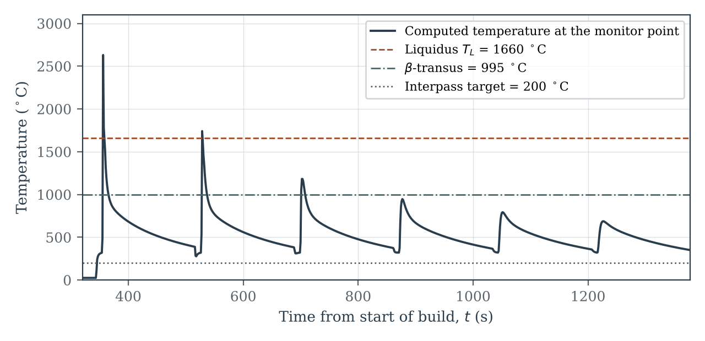
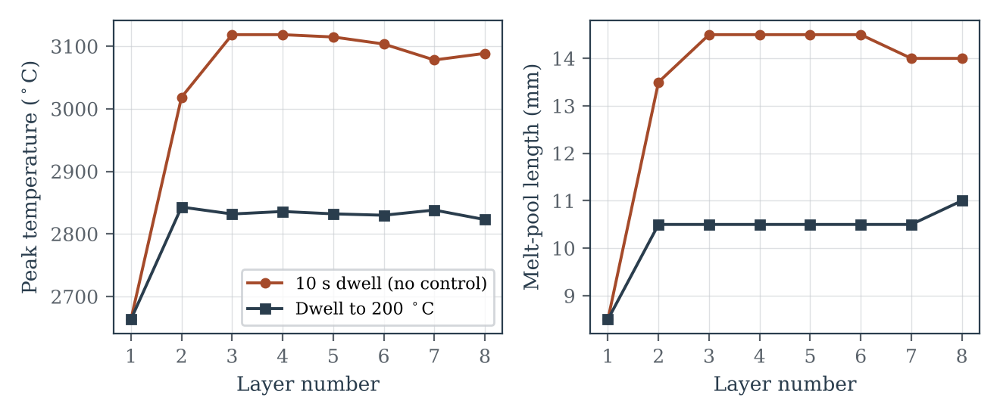
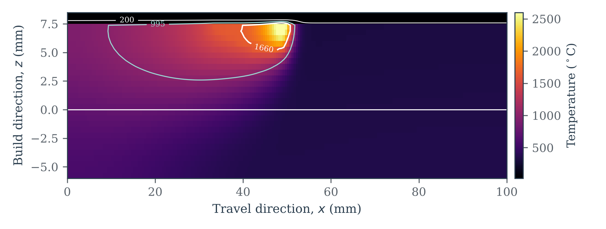
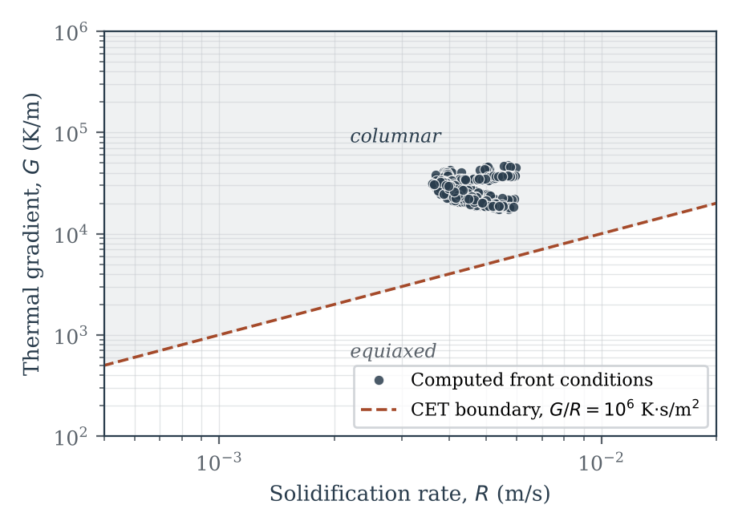
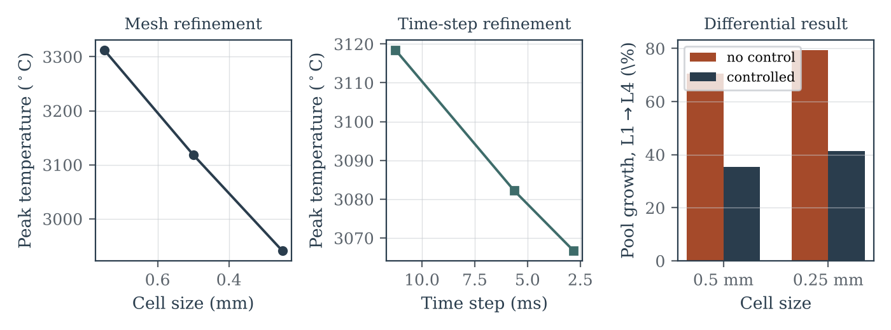
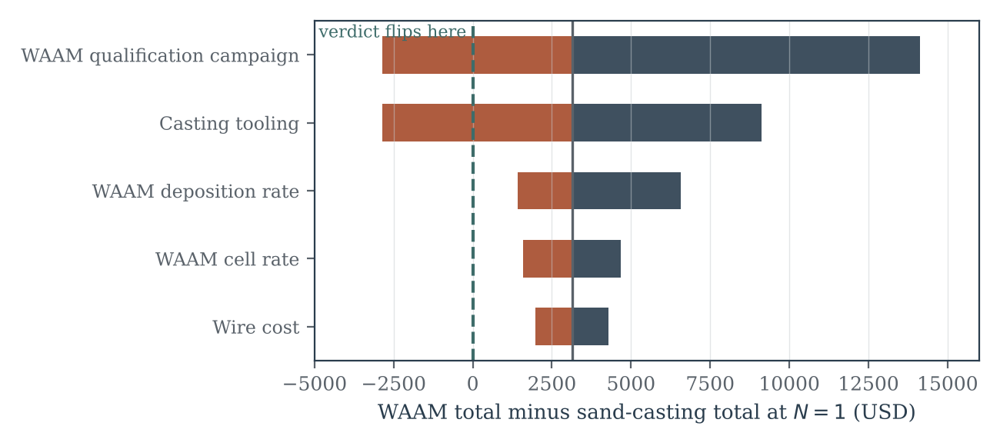

# WAAM Thermal Simulation — MCL135

Supplementary code for the report **"Wire Arc Additive Manufacturing: Process Fundamentals, Thermal Behaviour, and Techno-Economic Assessment"** (MCL135 — Welding and Allied Processes, Topic T37, IIT Delhi).

This repository contains the complete source for the numerical thermal model presented in Section 6 of the report and the techno-economic sensitivity analysis of Section 7. Every figure and every number quoted in those sections is reproduced by running the scripts here — nothing is hand-entered.

---

## What the model does

A **two-dimensional transient heat-conduction solver** for a thin wall built up layer by layer by wire arc additive manufacturing. It is written from scratch in NumPy: no FEA package, no commercial solver.

The model captures the four things that actually govern WAAM thermal history:

1. **A moving Gaussian heat source** traversing the top of the most recently deposited layer.
2. **Layer activation** — each new layer's cells are switched on at ambient temperature when deposition of that layer begins, so the growing geometry is represented rather than assumed.
3. **Latent heat of fusion**, through an effective heat capacity across the solidification interval.
4. **Surface losses** — convection and radiation from both faces of the thin wall and from the free top surface.

Its purpose is to answer one question quantitatively: **does interpass temperature control actually matter, and by how much?** The model compares two deposition policies under otherwise identical conditions — a fixed short dwell between layers, and a dwell extended until the part cools below a specified interpass temperature.

---

## Governing equation

Transient conduction with a volumetric source and lumped surface losses:

$$\rho c_p^{\text{eff}}(T)\,\frac{\partial T}{\partial t} = k\left(\frac{\partial^2 T}{\partial x^2} + \frac{\partial^2 T}{\partial z^2}\right) + \dot{q}_{\text{arc}}(x, z, t) + \dot{q}_{\text{surf}}(T)$$

**Moving Gaussian arc source**, normalised so that its volume integral recovers the net arc power $Q = \eta V I$ over a wall of thickness $w$:

$$\dot{q}_{\text{arc}} = \frac{3Q}{\pi r_0^2 w}\,\exp\!\left(-\frac{3\left[(x - v t)^2 + (z - z_s)^2\right]}{r_0^2}\right)$$

**Latent heat** by effective heat capacity across the solidification interval:

$$c_p^{\text{eff}} = c_p + \frac{L_f}{T_L - T_S} \quad \text{for} \quad T_S < T < T_L$$

**Surface losses**, lumped over the wall thickness for the two side faces and applied per cell height on the free top face:

$$\dot{q}_{\text{surf}} = -\frac{2}{w}\left[h(T - T_\infty) + \varepsilon\sigma\left(T^4 - T_\infty^4\right)\right]$$

**Discretisation** is explicit second-order central in space, forward Euler in time, with the time step fixed by the conditional-stability limit of the 2D explicit scheme:

$$\Delta t = 0.12\,\frac{\Delta x^2}{\alpha}, \qquad \alpha = \frac{k}{\rho c_p}$$

The safety factor of 0.12 sits well inside the theoretical limit of 0.25 for equal cell dimensions, which leaves headroom for the source and surface terms added to the same explicit update.

---

## Model parameters

Material properties are for **Ti–6Al–4V**, taken at representative elevated-temperature values rather than room temperature.

| Quantity | Symbol | Value |
|---|---|---|
| Density | ρ | 4430 kg/m³ |
| Specific heat | c_p | 610 J/kg·K |
| Thermal conductivity | k | 7.2 W/m·K |
| Latent heat of fusion | L_f | 286 kJ/kg |
| Solidus / liquidus | T_S / T_L | 1877 K / 1933 K |
| β-transus | T_β | 1268 K |
| Emissivity | ε | 0.4 |
| Convection coefficient | h | 15 W/m²·K |
| Arc current / voltage | I / V | 160 A / 11 V |
| Arc efficiency (GTAW) | η | 0.62 |
| Travel speed | v | 4.5 mm/s |
| Source radius | r₀ | 3.0 mm |
| Wall thickness | w | 6.0 mm |
| Layer height | — | 1.5 mm |
| Wall length | — | 100 mm |
| Layers deposited | — | 8 |
| Cell size | Δx = Δz | 0.5 mm |
| Time step | Δt | 11.26 ms |
| Interpass target (controlled case) | — | 200 °C |

---

## Headline results

### Thermal history and heat accumulation

| Quantity | Controlled interpass | Short fixed dwell |
|---|---|---|
| Peak surface temperature, layer 1 → 8 | 2663 → 2823 °C | 2663 → 3089 °C |
| Instantaneous melt-pool length, layer 1 → 8 | 8.5 → 11.0 mm | 8.5 → 14.0 mm |
| Total build time | 1378 s | 258 s |

The short-dwell build is **5.3× faster** and accumulates heat relentlessly: melt-pool length grows 65% over eight layers against 29% under interpass control. This is the geometric-stability/productivity trade-off described qualitatively throughout the WAAM literature, here quantified on a specific wall.

### Solidification conditions

| Quantity | Median value |
|---|---|
| Thermal gradient *G* | 2.76 × 10⁴ K/m |
| Solidification rate *R* | 4.30 mm/s |
| Ratio *G/R* | 6.56 × 10⁶ K·s/m² |
| Samples | 584 |

*G/R* sits above the commonly cited columnar-to-equiaxed transition criterion of ~10⁶ K·s/m², which is consistent with the columnar prior-β morphology reported experimentally for as-deposited WAAM Ti–6Al–4V. **This is a consistency check, not a validation** — see Limitations.

### Verification

The computed solidification rate *R* recovers the imposed travel speed to within **4%**. The solidification front cannot physically advance faster than the heat source that creates it, so this independent agreement between an output and an input is the model's strongest internal check.

### Mesh and time-step convergence

| Refinement | Peak *T* | Melt-pool length |
|---|---|---|
| Δx = 0.75 mm | +12.6% | +26.9% |
| Δx = 0.50 mm | +6.0% | +11.5% |
| Δx = 0.25 mm | reference | reference |
| Δt = 11.26 ms | +1.7% | +3.6% |
| Δt = 5.63 ms | +0.5% | 0.0% |
| Δt = 2.81 ms | reference | reference |

**The time step is converged. The mesh is not converged in absolute terms** — each halving drops the peak about 6% with no sign of flattening, because a Gaussian source on a 0.5 mm grid spans only ~12 cells and stays more concentrated than the continuous source it represents. Absolute temperatures should therefore be read as an upper bound.

**The differential conclusion survives refinement**, which is what the report actually relies on:

| Cell size | Pool growth, no control | Pool growth, controlled | Separation |
|---|---|---|---|
| 0.50 mm | +70.6% | +35.3% | 35.3 pp |
| 0.25 mm | +79.3% | +41.4% | 37.9 pp |

Halving the mesh moves the separation the argument depends on by about 7% of its own value, leaving sign, order and magnitude intact.

### Cost model sensitivity

One-at-a-time sweep of the techno-economic model, ranked by influence on the single-unit cost margin:

| Input | Range | Swing in margin |
|---|---|---|
| WAAM qualification campaign | $8k–$25k | $17,000 |
| Casting tooling | $12k–$24k | $12,000 |
| WAAM deposition rate | 2–4 kg/h | $5,175 |
| WAAM cell rate | $70–$110/h | $3,067 |
| Wire cost | $20–$30/kg | $2,300 |

The qualification campaign dominates everything else. Solving for the campaign cost at which the two routes break even gives **$10,867** against a baseline assumption of $14,000 — so the report's headline cost conclusion holds by a margin of only about 22%, and is stated with that threshold attached.

---

## Figures

| | |
|---|---|
|  |  |
| Thermal cycle at a monitored point | Peak temperature and pool length per layer |
|  |  |
| Temperature field snapshot | *G*–*R* solidification map |
|  |  |
| Mesh, time-step and differential convergence | Cost-model sensitivity |

---

## Repository layout

```
src/
  01_thermal_model.py                  core 2D transient solver, both interpass policies
  02_convergence_mesh_timestep.py      mesh and time-step refinement study
  03_convergence_differential.py       differential test: both policies at two cell sizes
  04_cost_sensitivity.py               one-at-a-time sensitivity of the cost model
  05_figures_thermal.py                Figures 3-5 and 8 of the report
  06_figures_convergence_tornado.py    Figures 6 and 11 of the report
results/
  data/                                raw solver output (.dat, .npy, .json)
  figures/                             figures as PDF (for LaTeX) and PNG (for this page)
run_all.sh                             reproduces every result in order
requirements.txt                       Python dependencies
```

### Mapping to report sections

| Script | Report section | Produces |
|---|---|---|
| `01_thermal_model.py` | §6.1–6.4, 6.6–6.8 | Tables 3–4, Figures 3–5, 8 |
| `02_convergence_mesh_timestep.py` | §6.5 | Table 5 (upper block) |
| `03_convergence_differential.py` | §6.5 | Table 5 (lower block), Figure 6 right panel |
| `04_cost_sensitivity.py` | §7.9 | Table 10 |
| `05`, `06_figures_*.py` | §6, §7 | all figure PDFs |

---

## Running it

Requires Python 3.9 or later.

```bash
git clone https://github.com/stack-sapphire/WAAM-Thermal-Simulation-MCL135.git
cd WAAM-Thermal-Simulation-MCL135
pip install -r requirements.txt
bash run_all.sh
```

Or run any single stage:

```bash
python3 src/01_thermal_model.py
```

Scripts write into `results/data/` and `results/figures/` and print their key numbers to the terminal. They must be run in numerical order the first time, because the figure scripts read the data the solver scripts write.

**Runtime**, on an ordinary laptop: script 01 takes roughly 2–4 minutes, script 02 about 3 minutes, script 03 about 10–20 minutes (it includes a 0.25 mm mesh, which is 4× the cells and 4× the time steps of the baseline), and scripts 04–06 are near-instant. Total under half an hour.

---

## Limitations

Stated plainly, because they bound what the results can be used for.

- **Two-dimensional.** Heat conduction along the deposition direction is represented; conduction across the wall thickness is lumped into the surface-loss term. Valid for a thin wall, not for a bulky part.
- **No fluid flow.** Marangoni convection, arc pressure and droplet momentum are absent, so the melt pool is a conduction-only melt region, not a weld pool.
- **Mesh not converged in absolute terms.** Peak temperatures are an upper bound. Comparative quantities are robust; see the convergence table above.
- **Temperature-independent properties.** ρ, c_p and k are fixed at representative elevated-temperature values rather than varying with temperature.
- **Verified, not validated.** The model's internal consistency is checked against the imposed travel speed and against published WAAM behaviour, but **no thermocouple or thermographic data from this build exists**, because no physical deposition was performed. Agreement with literature trends is a consistency check and is not a substitute for experimental validation.

---

## License

MIT — see [LICENSE](LICENSE). The code may be reused freely with attribution.

## Author

Radha Gupta · Department of Mechanical Engineering, IIT Delhi · MCL135, 2026
